<!-- Generated by scripts/build.mjs from README.template.md. Edit the template, not this file. -->

<picture>
  <source media="(prefers-color-scheme: dark)" srcset="assets/banner-dark.svg">
  
</picture>

### Hail, traveller. I'm Elvis.

I'm a Design Engineer and I've been designing products since 2019. I co-founded [FiveBlooded](https://x.com/FiveBlooded), the studio building [Mazerance](https://x.com/Mazerance), its psychological co-op strategy game. I also founded [Halfwings](https://x.com/HalfwingsInc), the software and hardware development partner for technology businesses. Figma featured my work at [Config 2022](https://www.youtube.com/watch?v=JUTFghsG8nI), and I've [mentored 500+ design students](https://adplist.org/mentors/elvis-obi) across multiple platforms. Based in Nairobi, Kenya.

#### ❦ The Arsenal

<a href="https://github.com/obileonardo/hearth-macos"><picture><source media="(prefers-color-scheme: dark)" srcset="assets/arsenal/hearth-dark.svg">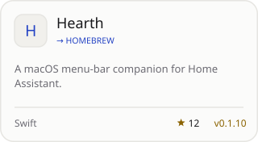</picture></a>
<a href="https://github.com/obileonardo/clepso"><picture><source media="(prefers-color-scheme: dark)" srcset="assets/arsenal/clepso-dark.svg">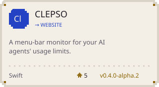</picture></a>
<a href="https://github.com/obileonardo/capsa-oss"><picture><source media="(prefers-color-scheme: dark)" srcset="assets/arsenal/capsa-dark.svg">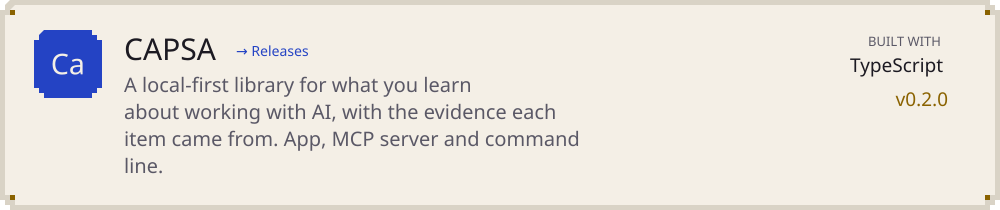</picture></a>
<a href="https://github.com/builders-world/builders-world"><picture><source media="(prefers-color-scheme: dark)" srcset="assets/arsenal/builders-world-dark.svg">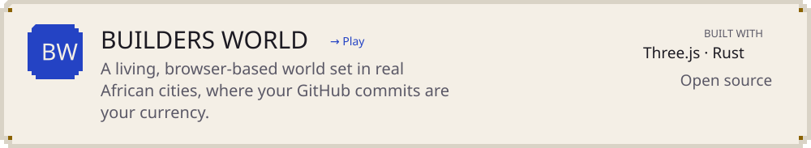</picture></a>
<a href="https://x.com/Mazerance"><picture><source media="(prefers-color-scheme: dark)" srcset="assets/arsenal/mazerance-dark.svg">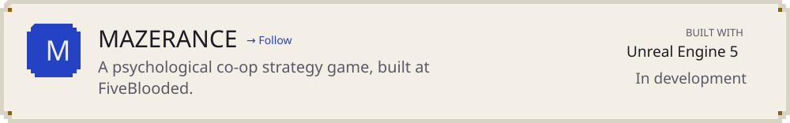</picture></a>
<a href="https://x.com/HalfwingsInc"><picture><source media="(prefers-color-scheme: dark)" srcset="assets/arsenal/halfwings-dark.svg">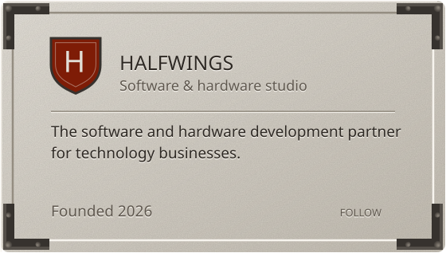</picture></a>

<a href="https://github.com/obileonardo/homebrew-hearth">Hearth: Homebrew</a> · <a href="https://clepso-app.vercel.app">Clepso: Website</a> · <a href="https://github.com/obileonardo/capsa-oss/releases">Capsa: Releases</a> · <a href="https://buildersworld.vercel.app">Builders World: Play</a> · <a href="https://x.com/Mazerance">Mazerance: Follow</a> · <a href="https://x.com/HalfwingsInc">Halfwings: Follow</a>

#### ❦ The Armoury

<picture>
  <source media="(prefers-color-scheme: dark)" srcset="assets/armoury-dark.svg">
  
</picture>

#### ❦ The Chronicle

| Role | House | Field | Since |
| --- | --- | --- | --- |
| **Founder** | [Halfwings](https://x.com/HalfwingsInc) | Software and hardware development for technology businesses | 2026 |
| **Co-founder** | [FiveBlooded](https://x.com/FiveBlooded) | Games: Mazerance | 2025 |
| **Design Engineer** | Independent | Products, brands and websites | 2019 |
| **Top Creator & Designer** | [Figma Config](https://www.youtube.com/watch?v=JUTFghsG8nI) | Recognised at the opening keynote, one of ~60 worldwide | 2022 |
| **Mentor** | [ADPList](https://adplist.org/mentors/elvis-obi) and other platforms | 500+ design students | 2022 |

#### ❦ Year in Review

<picture>
  <source media="(prefers-color-scheme: dark)" srcset="assets/year-dark.svg">
  
</picture>

#### ❦ Latest Dispatches

<picture>
  <source media="(prefers-color-scheme: dark)" srcset="assets/dispatches-dark.svg">
  
</picture>

<a href="https://github.com/obileonardo/capsa-oss/releases/tag/v0.2.0">Capsa v0.2.0</a> · <a href="https://github.com/obileonardo/capsa-oss/releases/tag/v0.1.0">Capsa v0.1.0</a> · <a href="https://github.com/obileonardo/clepso/releases/tag/v0.4.0-alpha.2">Clepso v0.4.0-alpha.2</a> · <a href="https://github.com/obileonardo/clepso/releases/tag/v0.4.0-alpha.1">Clepso v0.4.0-alpha.1</a> · <a href="https://github.com/obileonardo/clepso/releases/tag/v0.3.0-alpha.3">Clepso v0.3.0-alpha.3</a>

#### ❦ Elsewhere

  <a href="https://elvisobi.com"><picture><source media="(prefers-color-scheme: dark)" srcset="assets/seals/portfolio-dark.svg"></picture></a>
  <a href="https://x.com/TheObiLeonard"><picture><source media="(prefers-color-scheme: dark)" srcset="assets/seals/x-dark.svg"></picture></a>
  <a href="https://www.linkedin.com/in/elvisobi"><picture><source media="(prefers-color-scheme: dark)" srcset="assets/seals/linkedin-dark.svg">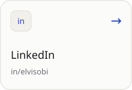</picture></a>
  <a href="https://contra.com/elvisobi"><picture><source media="(prefers-color-scheme: dark)" srcset="assets/seals/contra-dark.svg">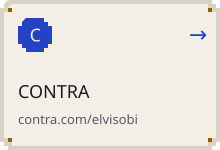</picture></a>
  <a href="mailto:contact@elvisobi.com?subject=A%20letter%20for%20Elvis"><picture><source media="(prefers-color-scheme: dark)" srcset="assets/seals/letter-dark.svg">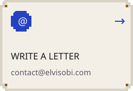</picture></a>

  <a href="https://elvisobi.com">elvisobi.com</a> · <a href="https://x.com/TheObiLeonard">X</a> · <a href="https://www.linkedin.com/in/elvisobi">LinkedIn</a> · <a href="https://contra.com/elvisobi">Contra</a> · <a href="mailto:contact@elvisobi.com">contact@elvisobi.com</a>

