<!-- Generated by scripts/build.mjs from README.template.md. Edit the template, not this file. -->

<picture>
  <source media="(prefers-color-scheme: dark)" srcset="assets/story-place-global-night.webp">
  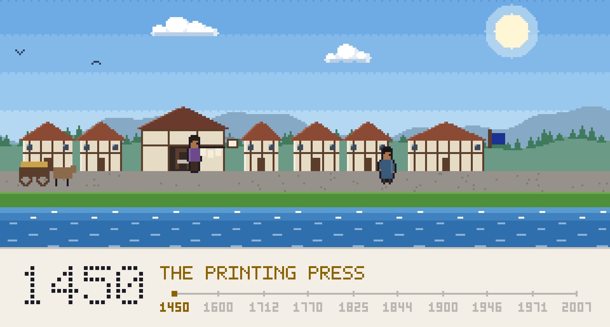
</picture>

<h3><picture><source media="(prefers-color-scheme: dark)" srcset="assets/headings/hail-traveller-i-m-elvis-dark.0116f0da.svg"></picture></h3>

I'm a Design Engineer and I've been designing products since 2019. I co-founded [FiveBlooded](https://x.com/FiveBlooded), the studio building [Mazerance](https://x.com/Mazerance), its psychological co-op strategy game. I also founded [Halfwings](https://x.com/HalfwingsInc), the software and hardware development partner for technology businesses. Figma featured my work at [Config 2022](https://www.youtube.com/watch?v=JUTFghsG8nI), and I've [mentored 500+ design students](https://adplist.org/mentors/elvis-obi) across multiple platforms. Based in Nairobi, Kenya.

<h3><picture><source media="(prefers-color-scheme: dark)" srcset="assets/headings/the-ledger-dark.66895017.svg"></picture></h3>

<a href="https://github.com/obileonardo?tab=repositories"><picture><source media="(prefers-color-scheme: dark)" srcset="assets/ledger-dark.450ac763.svg">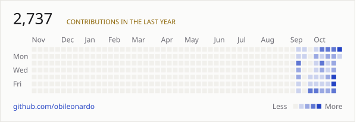</picture></a><picture><source media="(prefers-color-scheme: dark)" srcset="assets/year-dark.8b034ce1.svg">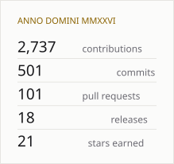</picture>

<h3><picture><source media="(prefers-color-scheme: dark)" srcset="assets/headings/the-arsenal-dark.1d92f642.svg"></picture></h3>

<a href="https://github.com/obileonardo/homebrew-hearth"><picture><source media="(prefers-color-scheme: dark)" srcset="assets/arsenal/hearth-dark.031da917.svg">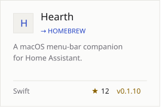</picture></a><a href="https://clepso-app.vercel.app"><picture><source media="(prefers-color-scheme: dark)" srcset="assets/arsenal/clepso-dark.3292a5a1.svg">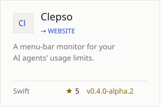</picture></a><a href="https://github.com/obileonardo/capsa-oss/releases"><picture><source media="(prefers-color-scheme: dark)" srcset="assets/arsenal/capsa-dark.c6f2ba95.svg">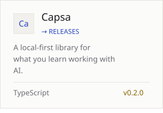</picture></a> 
<a href="https://buildersworld.vercel.app"><picture><source media="(prefers-color-scheme: dark)" srcset="assets/arsenal/builders-world-dark.a1330ab8.svg">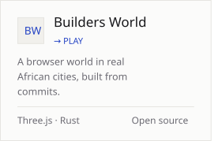</picture></a><a href="https://x.com/Mazerance"><picture><source media="(prefers-color-scheme: dark)" srcset="assets/arsenal/mazerance-dark.541c1aee.svg">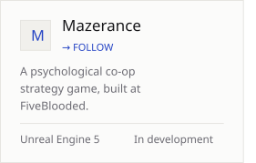</picture></a><a href="https://x.com/HalfwingsInc"><picture><source media="(prefers-color-scheme: dark)" srcset="assets/arsenal/halfwings-dark.5cdb33e1.svg">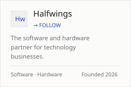</picture></a>

<h3><picture><source media="(prefers-color-scheme: dark)" srcset="assets/headings/hold-the-keep-dark.414764bc.svg"></picture></h3>

<!-- keep:start -->

<picture><source media="(prefers-color-scheme: dark)" srcset="assets/keep/panel-7eb94c09-dark.ec2469fd.svg">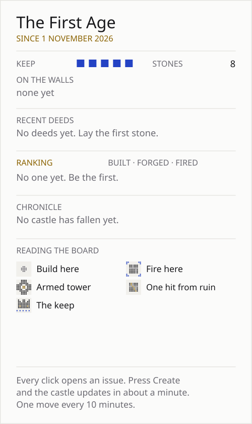</picture>
<picture><source media="(prefers-color-scheme: dark)" srcset="assets/keep/e0-dark.1ad1f4a6.svg"></picture><picture><source media="(prefers-color-scheme: dark)" srcset="assets/keep/e0-dark.1ad1f4a6.svg"></picture><picture><source media="(prefers-color-scheme: dark)" srcset="assets/keep/e0-dark.1ad1f4a6.svg"></picture><picture><source media="(prefers-color-scheme: dark)" srcset="assets/keep/e0-dark.1ad1f4a6.svg"></picture><picture><source media="(prefers-color-scheme: dark)" srcset="assets/keep/e0-dark.1ad1f4a6.svg"></picture><picture><source media="(prefers-color-scheme: dark)" srcset="assets/keep/e0-dark.1ad1f4a6.svg"></picture><picture><source media="(prefers-color-scheme: dark)" srcset="assets/keep/e0-dark.1ad1f4a6.svg"></picture>
 
<picture><source media="(prefers-color-scheme: dark)" srcset="assets/keep/e0-dark.1ad1f4a6.svg"></picture><picture><source media="(prefers-color-scheme: dark)" srcset="assets/keep/e0-dark.1ad1f4a6.svg"></picture><a href="https://github.com/obileonardo/obileonardo/issues/new?title=keep%3A%20build%20C2&amp;body=Lay%20a%20stone%20at%20C2.%0A%0ALeave%20the%20title%20as%20it%20is%20and%20press%20**Create**.%20The%20castle%20updates%20in%20about%20a%20minute%2C%20and%20a%20reply%20here%20tells%20you%20what%20happened.%20One%20move%20every%2010%20minutes."><picture><source media="(prefers-color-scheme: dark)" srcset="assets/keep/e1-dark.88786d66.svg"></picture></a><a href="https://github.com/obileonardo/obileonardo/issues/new?title=keep%3A%20build%20D2&amp;body=Lay%20a%20stone%20at%20D2.%0A%0ALeave%20the%20title%20as%20it%20is%20and%20press%20**Create**.%20The%20castle%20updates%20in%20about%20a%20minute%2C%20and%20a%20reply%20here%20tells%20you%20what%20happened.%20One%20move%20every%2010%20minutes."><picture><source media="(prefers-color-scheme: dark)" srcset="assets/keep/e1-dark.88786d66.svg"></picture></a><a href="https://github.com/obileonardo/obileonardo/issues/new?title=keep%3A%20build%20E2&amp;body=Lay%20a%20stone%20at%20E2.%0A%0ALeave%20the%20title%20as%20it%20is%20and%20press%20**Create**.%20The%20castle%20updates%20in%20about%20a%20minute%2C%20and%20a%20reply%20here%20tells%20you%20what%20happened.%20One%20move%20every%2010%20minutes."><picture><source media="(prefers-color-scheme: dark)" srcset="assets/keep/e1-dark.88786d66.svg"></picture></a><picture><source media="(prefers-color-scheme: dark)" srcset="assets/keep/e0-dark.1ad1f4a6.svg"></picture><picture><source media="(prefers-color-scheme: dark)" srcset="assets/keep/e0-dark.1ad1f4a6.svg"></picture>
 
<picture><source media="(prefers-color-scheme: dark)" srcset="assets/keep/e0-dark.1ad1f4a6.svg"></picture><a href="https://github.com/obileonardo/obileonardo/issues/new?title=keep%3A%20build%20B3&amp;body=Lay%20a%20stone%20at%20B3.%0A%0ALeave%20the%20title%20as%20it%20is%20and%20press%20**Create**.%20The%20castle%20updates%20in%20about%20a%20minute%2C%20and%20a%20reply%20here%20tells%20you%20what%20happened.%20One%20move%20every%2010%20minutes."><picture><source media="(prefers-color-scheme: dark)" srcset="assets/keep/e1-dark.88786d66.svg"></picture></a><a href="https://github.com/obileonardo/obileonardo/issues/new?title=keep%3A%20fire%20C3&amp;body=Fire%20the%20trebuchet%20at%20C3.%0A%0ALeave%20the%20title%20as%20it%20is%20and%20press%20**Create**.%20The%20castle%20updates%20in%20about%20a%20minute%2C%20and%20a%20reply%20here%20tells%20you%20what%20happened.%20One%20move%20every%2010%20minutes."><picture><source media="(prefers-color-scheme: dark)" srcset="assets/keep/s2t-6x-dark.15f2ced8.svg"></picture></a><a href="https://github.com/obileonardo/obileonardo/issues/new?title=keep%3A%20fire%20D3&amp;body=Fire%20the%20trebuchet%20at%20D3.%0A%0ALeave%20the%20title%20as%20it%20is%20and%20press%20**Create**.%20The%20castle%20updates%20in%20about%20a%20minute%2C%20and%20a%20reply%20here%20tells%20you%20what%20happened.%20One%20move%20every%2010%20minutes."><picture><source media="(prefers-color-scheme: dark)" srcset="assets/keep/s2-7x-dark.fb747215.svg"></picture></a><a href="https://github.com/obileonardo/obileonardo/issues/new?title=keep%3A%20fire%20E3&amp;body=Fire%20the%20trebuchet%20at%20E3.%0A%0ALeave%20the%20title%20as%20it%20is%20and%20press%20**Create**.%20The%20castle%20updates%20in%20about%20a%20minute%2C%20and%20a%20reply%20here%20tells%20you%20what%20happened.%20One%20move%20every%2010%20minutes."><picture><source media="(prefers-color-scheme: dark)" srcset="assets/keep/s2t-3x-dark.dbb0bba0.svg"></picture></a><a href="https://github.com/obileonardo/obileonardo/issues/new?title=keep%3A%20build%20F3&amp;body=Lay%20a%20stone%20at%20F3.%0A%0ALeave%20the%20title%20as%20it%20is%20and%20press%20**Create**.%20The%20castle%20updates%20in%20about%20a%20minute%2C%20and%20a%20reply%20here%20tells%20you%20what%20happened.%20One%20move%20every%2010%20minutes."><picture><source media="(prefers-color-scheme: dark)" srcset="assets/keep/e1-dark.88786d66.svg"></picture></a><picture><source media="(prefers-color-scheme: dark)" srcset="assets/keep/e0-dark.1ad1f4a6.svg"></picture>
 
<picture><source media="(prefers-color-scheme: dark)" srcset="assets/keep/e0-dark.1ad1f4a6.svg"></picture><a href="https://github.com/obileonardo/obileonardo/issues/new?title=keep%3A%20build%20B4&amp;body=Lay%20a%20stone%20at%20B4.%0A%0ALeave%20the%20title%20as%20it%20is%20and%20press%20**Create**.%20The%20castle%20updates%20in%20about%20a%20minute%2C%20and%20a%20reply%20here%20tells%20you%20what%20happened.%20One%20move%20every%2010%20minutes."><picture><source media="(prefers-color-scheme: dark)" srcset="assets/keep/e1-dark.88786d66.svg"></picture></a><a href="https://github.com/obileonardo/obileonardo/issues/new?title=keep%3A%20fire%20C4&amp;body=Fire%20the%20trebuchet%20at%20C4.%0A%0ALeave%20the%20title%20as%20it%20is%20and%20press%20**Create**.%20The%20castle%20updates%20in%20about%20a%20minute%2C%20and%20a%20reply%20here%20tells%20you%20what%20happened.%20One%20move%20every%2010%20minutes."><picture><source media="(prefers-color-scheme: dark)" srcset="assets/keep/s2-ex-dark.ae67e275.svg"></picture></a><picture><source media="(prefers-color-scheme: dark)" srcset="assets/keep/k5-dark.7294ef9e.svg"></picture><a href="https://github.com/obileonardo/obileonardo/issues/new?title=keep%3A%20fire%20E4&amp;body=Fire%20the%20trebuchet%20at%20E4.%0A%0ALeave%20the%20title%20as%20it%20is%20and%20press%20**Create**.%20The%20castle%20updates%20in%20about%20a%20minute%2C%20and%20a%20reply%20here%20tells%20you%20what%20happened.%20One%20move%20every%2010%20minutes."><picture><source media="(prefers-color-scheme: dark)" srcset="assets/keep/s2-bx-dark.878cb76d.svg"></picture></a><a href="https://github.com/obileonardo/obileonardo/issues/new?title=keep%3A%20build%20F4&amp;body=Lay%20a%20stone%20at%20F4.%0A%0ALeave%20the%20title%20as%20it%20is%20and%20press%20**Create**.%20The%20castle%20updates%20in%20about%20a%20minute%2C%20and%20a%20reply%20here%20tells%20you%20what%20happened.%20One%20move%20every%2010%20minutes."><picture><source media="(prefers-color-scheme: dark)" srcset="assets/keep/e1-dark.88786d66.svg"></picture></a><picture><source media="(prefers-color-scheme: dark)" srcset="assets/keep/e0-dark.1ad1f4a6.svg"></picture>
 
<picture><source media="(prefers-color-scheme: dark)" srcset="assets/keep/e0-dark.1ad1f4a6.svg"></picture><a href="https://github.com/obileonardo/obileonardo/issues/new?title=keep%3A%20build%20B5&amp;body=Lay%20a%20stone%20at%20B5.%0A%0ALeave%20the%20title%20as%20it%20is%20and%20press%20**Create**.%20The%20castle%20updates%20in%20about%20a%20minute%2C%20and%20a%20reply%20here%20tells%20you%20what%20happened.%20One%20move%20every%2010%20minutes."><picture><source media="(prefers-color-scheme: dark)" srcset="assets/keep/e1-dark.88786d66.svg"></picture></a><a href="https://github.com/obileonardo/obileonardo/issues/new?title=keep%3A%20fire%20C5&amp;body=Fire%20the%20trebuchet%20at%20C5.%0A%0ALeave%20the%20title%20as%20it%20is%20and%20press%20**Create**.%20The%20castle%20updates%20in%20about%20a%20minute%2C%20and%20a%20reply%20here%20tells%20you%20what%20happened.%20One%20move%20every%2010%20minutes."><picture><source media="(prefers-color-scheme: dark)" srcset="assets/keep/s2t-cx-dark.4093ea48.svg"></picture></a><a href="https://github.com/obileonardo/obileonardo/issues/new?title=keep%3A%20fire%20D5&amp;body=Fire%20the%20trebuchet%20at%20D5.%0A%0ALeave%20the%20title%20as%20it%20is%20and%20press%20**Create**.%20The%20castle%20updates%20in%20about%20a%20minute%2C%20and%20a%20reply%20here%20tells%20you%20what%20happened.%20One%20move%20every%2010%20minutes."><picture><source media="(prefers-color-scheme: dark)" srcset="assets/keep/s2-dx-dark.99a63575.svg"></picture></a><a href="https://github.com/obileonardo/obileonardo/issues/new?title=keep%3A%20fire%20E5&amp;body=Fire%20the%20trebuchet%20at%20E5.%0A%0ALeave%20the%20title%20as%20it%20is%20and%20press%20**Create**.%20The%20castle%20updates%20in%20about%20a%20minute%2C%20and%20a%20reply%20here%20tells%20you%20what%20happened.%20One%20move%20every%2010%20minutes."><picture><source media="(prefers-color-scheme: dark)" srcset="assets/keep/s2t-9x-dark.8b9a00c0.svg"></picture></a><a href="https://github.com/obileonardo/obileonardo/issues/new?title=keep%3A%20build%20F5&amp;body=Lay%20a%20stone%20at%20F5.%0A%0ALeave%20the%20title%20as%20it%20is%20and%20press%20**Create**.%20The%20castle%20updates%20in%20about%20a%20minute%2C%20and%20a%20reply%20here%20tells%20you%20what%20happened.%20One%20move%20every%2010%20minutes."><picture><source media="(prefers-color-scheme: dark)" srcset="assets/keep/e1-dark.88786d66.svg"></picture></a><picture><source media="(prefers-color-scheme: dark)" srcset="assets/keep/e0-dark.1ad1f4a6.svg"></picture>
 
<picture><source media="(prefers-color-scheme: dark)" srcset="assets/keep/e0-dark.1ad1f4a6.svg"></picture><picture><source media="(prefers-color-scheme: dark)" srcset="assets/keep/e0-dark.1ad1f4a6.svg"></picture><a href="https://github.com/obileonardo/obileonardo/issues/new?title=keep%3A%20build%20C6&amp;body=Lay%20a%20stone%20at%20C6.%0A%0ALeave%20the%20title%20as%20it%20is%20and%20press%20**Create**.%20The%20castle%20updates%20in%20about%20a%20minute%2C%20and%20a%20reply%20here%20tells%20you%20what%20happened.%20One%20move%20every%2010%20minutes."><picture><source media="(prefers-color-scheme: dark)" srcset="assets/keep/e1-dark.88786d66.svg"></picture></a><a href="https://github.com/obileonardo/obileonardo/issues/new?title=keep%3A%20build%20D6&amp;body=Lay%20a%20stone%20at%20D6.%0A%0ALeave%20the%20title%20as%20it%20is%20and%20press%20**Create**.%20The%20castle%20updates%20in%20about%20a%20minute%2C%20and%20a%20reply%20here%20tells%20you%20what%20happened.%20One%20move%20every%2010%20minutes."><picture><source media="(prefers-color-scheme: dark)" srcset="assets/keep/e1-dark.88786d66.svg"></picture></a><a href="https://github.com/obileonardo/obileonardo/issues/new?title=keep%3A%20build%20E6&amp;body=Lay%20a%20stone%20at%20E6.%0A%0ALeave%20the%20title%20as%20it%20is%20and%20press%20**Create**.%20The%20castle%20updates%20in%20about%20a%20minute%2C%20and%20a%20reply%20here%20tells%20you%20what%20happened.%20One%20move%20every%2010%20minutes."><picture><source media="(prefers-color-scheme: dark)" srcset="assets/keep/e1-dark.88786d66.svg"></picture></a><picture><source media="(prefers-color-scheme: dark)" srcset="assets/keep/e0-dark.1ad1f4a6.svg"></picture><picture><source media="(prefers-color-scheme: dark)" srcset="assets/keep/e0-dark.1ad1f4a6.svg"></picture>
 
<picture><source media="(prefers-color-scheme: dark)" srcset="assets/keep/e0-dark.1ad1f4a6.svg"></picture><picture><source media="(prefers-color-scheme: dark)" srcset="assets/keep/e0-dark.1ad1f4a6.svg"></picture><picture><source media="(prefers-color-scheme: dark)" srcset="assets/keep/e0-dark.1ad1f4a6.svg"></picture><picture><source media="(prefers-color-scheme: dark)" srcset="assets/keep/e0-dark.1ad1f4a6.svg"></picture><picture><source media="(prefers-color-scheme: dark)" srcset="assets/keep/e0-dark.1ad1f4a6.svg"></picture><picture><source media="(prefers-color-scheme: dark)" srcset="assets/keep/e0-dark.1ad1f4a6.svg"></picture><picture><source media="(prefers-color-scheme: dark)" srcset="assets/keep/e0-dark.1ad1f4a6.svg"></picture>
 
<picture><source media="(prefers-color-scheme: dark)" srcset="assets/keep/forgebar-291b26c8-dark.797d631b.svg">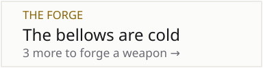</picture><a href="https://github.com/obileonardo/obileonardo/issues/new?title=keep%3A%20forge%20iron&amp;body=Add%20iron%20to%20the%20forge.%20Every%20third%20material%20forges%20a%20weapon%20that%20guards%20a%20tower.%0A%0ALeave%20the%20title%20as%20it%20is%20and%20press%20**Create**.%20The%20castle%20updates%20in%20about%20a%20minute%2C%20and%20a%20reply%20here%20tells%20you%20what%20happened.%20One%20move%20every%2010%20minutes."><picture><source media="(prefers-color-scheme: dark)" srcset="assets/keep/forge-iron-dark.164f712e.svg"></picture></a><a href="https://github.com/obileonardo/obileonardo/issues/new?title=keep%3A%20forge%20ember&amp;body=Add%20ember%20to%20the%20forge.%20Every%20third%20material%20forges%20a%20weapon%20that%20guards%20a%20tower.%0A%0ALeave%20the%20title%20as%20it%20is%20and%20press%20**Create**.%20The%20castle%20updates%20in%20about%20a%20minute%2C%20and%20a%20reply%20here%20tells%20you%20what%20happened.%20One%20move%20every%2010%20minutes."><picture><source media="(prefers-color-scheme: dark)" srcset="assets/keep/forge-ember-dark.a129ed9f.svg"></picture></a><a href="https://github.com/obileonardo/obileonardo/issues/new?title=keep%3A%20forge%20rune&amp;body=Add%20rune%20to%20the%20forge.%20Every%20third%20material%20forges%20a%20weapon%20that%20guards%20a%20tower.%0A%0ALeave%20the%20title%20as%20it%20is%20and%20press%20**Create**.%20The%20castle%20updates%20in%20about%20a%20minute%2C%20and%20a%20reply%20here%20tells%20you%20what%20happened.%20One%20move%20every%2010%20minutes."><picture><source media="(prefers-color-scheme: dark)" srcset="assets/keep/forge-rune-dark.079c183e.svg"></picture></a>

 
<!-- keep:end -->

<h3><picture><source media="(prefers-color-scheme: dark)" srcset="assets/headings/the-armoury-dark.36f3271b.svg"></picture></h3>

<picture>
  <source media="(prefers-color-scheme: dark)" srcset="assets/armoury-dark.c4436650.svg">
  
</picture>

<h3><picture><source media="(prefers-color-scheme: dark)" srcset="assets/headings/the-chronicle-dark.d7c62fa1.svg"></picture></h3>

<a href="https://www.linkedin.com/in/elvisobi"><picture><source media="(prefers-color-scheme: dark)" srcset="assets/chronicle-dark.7de2db8d.svg">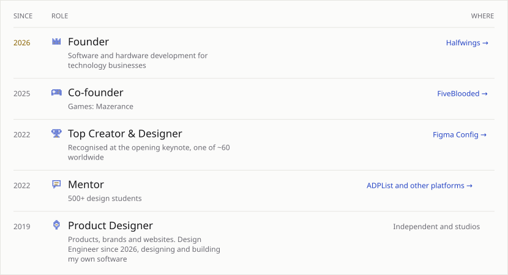</picture></a>

<h3><picture><source media="(prefers-color-scheme: dark)" srcset="assets/headings/latest-dispatches-dark.49b8f5d0.svg"></picture></h3>

<a href="https://github.com/obileonardo/capsa-oss/releases/tag/v0.2.0"><picture><source media="(prefers-color-scheme: dark)" srcset="assets/dispatches/0-dark.d9cce6bc.svg">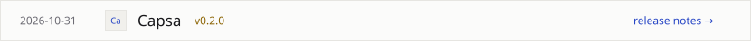</picture></a>
<a href="https://github.com/obileonardo/capsa-oss/releases/tag/v0.1.0"><picture><source media="(prefers-color-scheme: dark)" srcset="assets/dispatches/1-dark.77b6b32e.svg">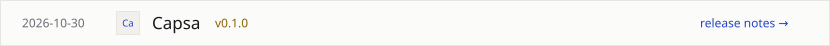</picture></a>
<a href="https://github.com/obileonardo/clepso/releases/tag/v0.4.0-alpha.2"><picture><source media="(prefers-color-scheme: dark)" srcset="assets/dispatches/2-dark.ad1883c6.svg"></picture></a>
<a href="https://github.com/obileonardo/clepso/releases/tag/v0.4.0-alpha.1"><picture><source media="(prefers-color-scheme: dark)" srcset="assets/dispatches/3-dark.135fcfa6.svg">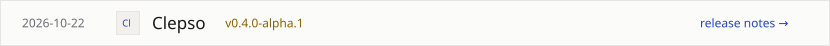</picture></a>
<a href="https://github.com/obileonardo/clepso/releases/tag/v0.3.0-alpha.3"><picture><source media="(prefers-color-scheme: dark)" srcset="assets/dispatches/4-dark.7fecf257.svg">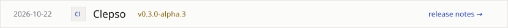</picture></a>

<h3><picture><source media="(prefers-color-scheme: dark)" srcset="assets/headings/elsewhere-dark.c705c2d3.svg"></picture></h3>

<a href="https://elvisobi.com"><picture><source media="(prefers-color-scheme: dark)" srcset="assets/seals/portfolio-dark.3ff09a46.svg"></picture></a><a href="https://x.com/TheObiLeonard"><picture><source media="(prefers-color-scheme: dark)" srcset="assets/seals/x-dark.87dd9f81.svg">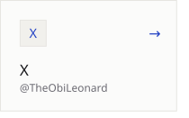</picture></a><a href="https://www.linkedin.com/in/elvisobi"><picture><source media="(prefers-color-scheme: dark)" srcset="assets/seals/linkedin-dark.d5942d60.svg">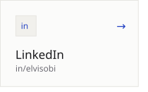</picture></a><a href="https://contra.com/elvisobi"><picture><source media="(prefers-color-scheme: dark)" srcset="assets/seals/contra-dark.b4437b67.svg">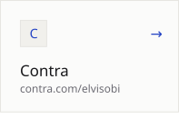</picture></a> 
<a href="mailto:contact@elvisobi.com?subject=A%20letter%20for%20Elvis"><picture><source media="(prefers-color-scheme: dark)" srcset="assets/seals/letter-dark.501378ff.svg"></picture></a>

