<picture>
  <source media="(prefers-color-scheme: dark)" srcset="assets/story-place-global-night.webp">
  
</picture>

### Hail, traveller. I'm Elvis

I'm a Design Engineer and I've been designing products since 2019. I co-founded [FiveBlooded](https://x.com/FiveBlooded), the studio building [Mazerance](https://x.com/Mazerance), its psychological co-op strategy game. I also founded [Halfwings](https://x.com/HalfwingsInc), the software and hardware development partner for technology businesses. Figma featured my work at [Config 2022](https://www.youtube.com/watch?v=JUTFghsG8nI), and I've [mentored 500+ design students](https://adplist.org/mentors/elvis-obi) across multiple platforms. Based in Nairobi, Kenya.

#### ❦ The Ledger

{{LEDGER}}

#### ❦ The Arsenal

{{ARSENAL}}

#### ❦ Hold the Keep

{{KEEP}}

#### ❦ The Armoury

<picture>
  <source media="(prefers-color-scheme: dark)" srcset="assets/armoury-dark.svg">
  
</picture>

#### ❦ The Chronicle

{{CHRONICLE}}

#### ❦ Latest Dispatches

{{DISPATCHES}}

#### ❦ Elsewhere

{{SEALS}}

